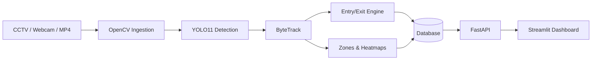

<div align="center">

# 👥 CrowdSense AI

### Real-Time Building Occupancy & Space Intelligence Platform


*Detect · Track · Count · Forecast — without facial recognition.*

</div>

---

## ✨ Highlights

- 🎯 **Person detection** with YOLO11 (CPU or NVIDIA GPU)
- 🧭 **Multi-object tracking** with ByteTrack temporary IDs *(Phase 3)*
- 🚪 **Entry/exit counting** via virtual lines *(Phase 4)*
- 🗺️ **Zones, density & heatmaps** *(Phase 5)*
- 📈 **Peak hours & forecasting** *(Phase 6)*
- ⚡ **FastAPI** backend + 📊 **Streamlit** dashboard *(Phases 7–8)*
- 🔒 **Privacy-first**: no face recognition, only anonymous track IDs

## 🏗️ Architecture



## 🧱 Tech Stack

| Layer | Technology |
|---|---|
| Detection | YOLO11 (Ultralytics) |
| Tracking | ByteTrack |
| Video | OpenCV |
| Utilities | Supervision |
| Backend | FastAPI + SQLAlchemy |
| Dashboard | Streamlit + Plotly |
| Analytics | NumPy, Pandas, scikit-learn |

## 🚀 Quick Start (Windows PowerShell)

```powershell
py -3.11 -m venv venv
.\venv\Scripts\Activate.ps1
python -m pip install --upgrade pip
pip install -r requirements.txt

# put a video in data/videos/, then:
python scripts/run_detection.py --source data/videos/entrance.mp4 --save
```

| Flag | Description | Default |
|---|---|---|
| `--source` | MP4 path, webcam index, or RTSP URL | `0` |
| `--weights` | YOLO weights | `yolo11n.pt` |
| `--conf` | Confidence threshold | `0.35` |
| `--device` | `cpu` or `cuda:0` | `cpu` |
| `--fps` | Processing FPS | `10` |
| `--save` | Save annotated video | off |
| `--no-show` | Headless mode | off |

Outputs go to `data/output/` (`detections.mp4`, `detections_log.csv`).

## 🗺️ Roadmap

- [x] Phase 1 — Video ingestion
- [x] Phase 2 — YOLO person detection
- [ ] Phase 3 — ByteTrack tracking
- [ ] Phase 4 — Entry/exit counting
- [ ] Phase 5 — Zones, density, heatmaps
- [ ] Phase 6 — Business analytics & forecasting
- [ ] Phase 7 — FastAPI backend
- [ ] Phase 8 — Streamlit dashboard
- [ ] Phase 9 — Testing & optimization

## 📏 Evaluation Metrics

Counting MAE · Detection precision/recall · IDF1 / HOTA · FPS · End-to-end latency

## 🔐 Privacy & Ethics

Use consented footage only, restrict access, and never perform facial identification. Track IDs are temporary and anonymous. A frame's person count is **not** building occupancy; occupancy needs tracking, calibrated lines, a known starting count and reconciliation checks.

## 📁 Structure

```
CrowdSense-AI/
├── backend/app/{api,core,models,database}
├── vision_engine/   # video_processor, detector (+ tracker, counter, zones…)
├── analytics/
├── dashboard/
├── data/{videos,processed,output}
├── scripts/run_detection.py
└── tests/
```

## 📚 Datasets

MOTChallenge · CrowdHuman · ShanghaiTech Crowd Counting · your own staged entrance/exit videos.
